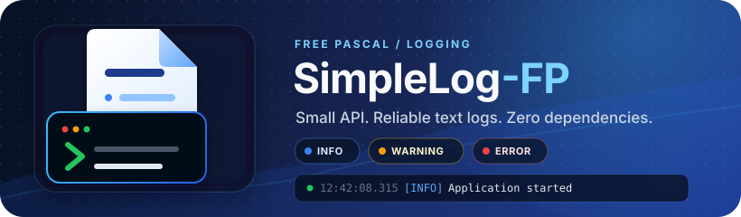

# 📝 SimpleLog-FP 

<p align="center">
  
</p>

[](https://opensource.org/licenses/MIT)
[](https://www.freepascal.org/)
[](https://www.lazarus-ide.org/)


[](CHANGELOG.md)


> [!Note]
> SimpleLog-FP 1.0.0 provides the first stable public API. Feedback and focused improvements remain welcome.


A **simple**, **lightweight**, and **easy-to-use** logging library for Free Pascal applications.

> **Why SimpleLog-FP?** 🤔 Built for projects that want logs without ceremony — clean, reliable output to console, file, or both, with a small API you can learn in a few minutes.

## 🎯 Design Philosophy

- ✅ **Simple** - Easy for new developers to understand and use
- ✅ **Lightweight** - One focused source unit, no framework or runtime setup
- ✅ **Maintainable** - Clean code and easily maintainable
- ✅ **Focused** - Does three things well: console, file, and console+file logging
- ✅ **No dependencies** - Uses only standard Free Pascal units
- ✅ **Cross-platform** - Works on Windows and Unix systems
- ✅ **File rotation** - Automatic log file rotation when size limits are reached

## 🚀 Quick Start

### 📦 Installation

**From GitHub:**

```bash
git clone https://github.com/ikelaiah/simplelog-fp.git
cd simplelog-fp
```

**Manual Installation:**

1. Download `src/SimpleLog.pas` from this repository
2. Copy it to your project directory
3. Add `SimpleLog` to your uses clause
4. Start logging!

### Basic Usage

```pascal
uses SimpleLog;

var
  Log: TSimpleLog;
begin
  // Console only
  Log := TSimpleLog.Console;
  Log.Info('Hello World!');
  
  // File only  
  Log := TSimpleLog.FileLog('app.log');
  Log.Info('Logged to file');
  
  // Both console and file
  Log := TSimpleLog.Both('app.log');
  Log.Info('Appears in both console and file');
end;
```

**That's it!** No complex setup, no memory management, no configuration files required.

For a short walkthrough, see [Getting Started](docs/getting-started.md).

### 🌟 A More Realistic Example

```pascal
program MyApplication;
uses SimpleLog, SysUtils;

var
  Log: TSimpleLog;
  UserCount: Integer;
begin
  // Log to both console and file; hide debug messages in production
  Log := TSimpleLog.Both('application.log')
    .SetMinLevel(llInfo);

  Log.Info('Application starting up');

  try
    UserCount := LoadUsers();
    Log.Info('Loaded %d users from database', [UserCount]);

    if UserCount = 0 then
      Log.Warning('No users found in database');
  except
    on E: Exception do
    begin
      Log.Error('Startup failed: %s', [E.Message]);
      ExitCode := 1;
      Exit;
    end;
  end;

  Log.Info('Application ready');
  // ... main application loop ...
  Log.Info('Application shutting down');
end;
```

### Archiving log files

```pascal
program myapplication;
uses
  {$IFDEF UNIX}
  cthreads, //Required for archiving
  {$ENDIF}
  SimpleLog, SysUtils;

var
  Log: TSimpleLog;
  UserCount: Integer;
  i : Word;
begin
  // Log to both console and file; hide debug messages in production
  Log := TSimpleLog.Both('archive.log')
   .SetMinLevel(llInfo)
   .SetMaxFileSize(1 * 1024 * 1024);
  Log.ArchiveLogFiles := True;
  Log.MaxRotateFiles := 5;

  for i := 0 to 15000 do
    Log.Info('This message №' + i.ToString + ' is written during log archiving');

  WriteLn
end.
```


## ✨ Features

### 📝 Core Logging

- **5 log levels**: Debug, Info, Warning, Error, Fatal
- **Timestamped messages**: Each log entry includes local wall-clock time with milliseconds displayed
- **Automatic colored console output** on interactive terminals, with always/never overrides
- **File logging** with automatic directory creation
- **Dual output** to both console and file simultaneously
- **Format string support** for all log methods
- **Thread safety** - logging, configuration calls, and property reads are serialized in-process
- **Silent mode** to temporarily disable all logging output
- **Configurable I/O error handling** - silent by default, with an opt-in exception mode

### Log Output Format

All log messages follow a consistent, readable format:

```
[2025-07-01 14:30:22.123] [INFO] Application started
[2025-07-01 14:30:22.456] [WARNING] Low disk space: 15.5% remaining
[2025-07-01 14:30:22.789] [ERROR] Database connection failed
[2025-07-01 14:30:23.012] [DEBUG] User authentication successful
[2025-07-01 14:30:23.345] [FATAL] Critical system error
```

**Timestamp format**: `yyyy-mm-dd hh:nn:ss.zzz`
- Local wall-clock time in a sortable, ISO-like format
- 24-hour time with milliseconds displayed
- No UTC offset or timezone is included
- Use a monotonic timer—not log timestamps—for performance measurements
- Consistent across console and file output

### ⚙️ Configuration
- **Method chaining** for fluent configuration
- **Log level filtering** - set minimum level to reduce noise
- **File rotation** - automatic rotation when files exceed size limit
- **Custom file paths** with automatic directory creation
- **Color control** - automatic terminal detection with always/never overrides

### 🌍 Cross-Platform
- **Windows**: Console colors via Windows API
- **Unix/Linux**: Console colors via ANSI escape codes
- **Consistent text format and file behavior** across platforms

## 📚 API Reference

### 🏭 Factory Methods
```pascal
TSimpleLog.Console              // Console output only
TSimpleLog.FileLog('file.log')  // File output only  
TSimpleLog.Both('file.log')     // Both console and file
```

### 🔊 Logging Methods
```pascal
Log.Debug('Debug message');
Log.Info('Information');
Log.Warning('Warning message');
Log.Error('Error occurred');
Log.Fatal('Critical error');

// Format string variants
Log.Info('User %s has %d items', [username, count]);
Log.Error('Connection failed: %s:%d', [host, port]);
```

### ⛓️ Configuration (Method Chaining)
```pascal
Log := TSimpleLog.Console
  .SetMinLevel(llWarning)           // Only warnings and above
  .SetOutputs([odConsole, odFile])  // Enable both outputs
  .SetFile('app.log')               // Set log file
  .SetMaxFileSize(5 * 1024 * 1024)  // 5MB rotation limit
  .SetSilent(False)                 // Enable/disable all logging
  .SetColorMode(ccmAuto)            // Auto, always, or never
  .SetErrorMode(lemSilent);          // Choose silent or exception behavior
```

### 🔧 Read-Only Properties
```pascal
WriteLn(Log.LogFile);                // Current log file path
WriteLn(Ord(Log.MinLevel));          // Current minimum log level
WriteLn(Log.MaxFileSize);            // Current rotation size
WriteLn(Log.Silent);                 // Current silent mode
WriteLn(Ord(Log.ColorMode));          // Current console color mode
WriteLn(Ord(Log.ErrorMode));          // Current file error mode
```

Use the `Set...` methods for configuration. This keeps validation in one place and avoids direct property writes bypassing rules such as the minimum rotation size.

## 📋 More Examples

### 🔍 Level Filtering
```pascal
// Production: Only show warnings and errors
Log := TSimpleLog.Both('prod.log').SetMinLevel(llWarning);

// Development: Show everything including debug
Log := TSimpleLog.Console.SetMinLevel(llDebug);
```

### 🔄 File Rotation
```pascal
// Rotate when file exceeds 1MB
Log := TSimpleLog.FileLog('big.log').SetMaxFileSize(1024 * 1024);
Log.Info('This will rotate when file gets too big');
// Rotation keeps one bounded backup: big.log.1
```

### 🔇 Silent Mode
```pascal
// Temporarily disable all logging
Log := Log.SetSilent(True);
Log.Error('This error will not appear anywhere');

// Re-enable logging
Log := Log.SetSilent(False);
Log.Info('Logging is back on');
```

### 🎨 Plain Console Output
```pascal
// Auto is the default and avoids colors when output is redirected.
// Use ccmNever when plain output is required unconditionally.
Log := TSimpleLog.Console.SetColorMode(ccmNever);
Log.Info('No color control codes are written');
```

`SetUseColors(False)` remains available as a convenience alias for
`SetColorMode(ccmNever)`; `SetUseColors(True)` selects `ccmAlways`.

### 🚨 File Error Policy

```pascal
// The default lemSilent policy keeps logging failures non-fatal.
Log := TSimpleLog.FileLog('app.log').SetErrorMode(lemRaise);
try
  Log.Info('Write failures now raise ESimpleLogError');
except
  on E: ESimpleLogError do
    WriteLn(StdErr, E.Message);
end;
```

### 🧵 Thread Safety
```pascal
// Logging, configuration methods, and property reads are serialized internally.
// Configure before sharing when a multi-step configuration must be observed atomically.
var
  Log: TSimpleLog;
begin
  Log := TSimpleLog.Both('threaded.log');
  // Concurrent calls in this process are serialized
  Log.Info('Multi-threaded logging works reliably');
end;
```

## 💯 Advanced Record Benefits

SimpleLog uses Free Pascal's **advanced records** instead of classes:

- ✅ **No memory management** - no Create/Free needed
- ✅ **Stack allocated** - automatic cleanup
- ✅ **Lightweight** - minimal overhead
- ✅ **Value semantics** - can be copied safely
- ✅ **Modern Pascal** - leverages language features

## 📁 File Structure

```text
SimpleLog-FP/
├── src/
│   └── SimpleLog.pas          # Main library
├── examples/
│   ├── SimpleLogExample/      # Basic usage examples
│   └── ThreadSafeExample/     # Concurrent logging demo
├── tests/
│   ├── SimpleLog.Test.pas     # Comprehensive test suite
│   └── PackageConsumer.pas    # Lazarus package smoke consumer
├── packages/lazarus/
│   └── simplelog_fp.lpk       # Lazarus package
├── docs/
│   ├── getting-started.md     # Short first-use guide
│   ├── SimpleLogger.md        # User manual
│   ├── cheat-sheet.md         # Quick API reference
│   └── release-checklist.md   # Maintainer release checklist
└── README.md                  # This file
```

## 🧪 Tests

A comprehensive 39-test suite is provided in the `tests/` directory. To run it:

- Build the Lazarus test runner:
  ```bash
  lazbuild --build-mode=Debug tests/TestRunner.lpi
  ```
- Run the full suite:
  ```bash
  tests/TestRunner.exe --all --format=plainnotiming
  ```
- CI also builds and runs the test suite with Lazarus on Windows and plain FPC on Ubuntu.

## 📦 Lazarus Package

A ready-to-use Lazarus package is included for easy integration:

- Open `packages/lazarus/simplelog_fp.lpk` in the Lazarus IDE
- Click "Use" → "Add to Project" to add SimpleLog-FP to your project
- The package will automatically add the correct search paths

This is the recommended way to add SimpleLog-FP to your Lazarus projects for the best experience.

## 🎯 When SimpleLog-FP Fits

SimpleLog-FP is a good match when you want:

- **CLI tools and small utilities** that need readable, timestamped output without pulling in a framework
- **Small to medium applications** where console, file, or console+file logging covers your needs
- **Quick prototypes and scripts** where `uses SimpleLog; Log := TSimpleLog.Console;` is all the setup you want
- **Cross-platform projects** that need consistent behavior on Windows and Linux without extra dependencies
- **Multi-threaded code** that needs basic serialized logging without configuring appenders or handlers

If you need pluggable backends, structured/JSON logs, network sinks, or fine-grained per-category routing, a larger framework will serve you better — and that's fine. SimpleLog-FP is intentionally scoped to the common case.

## 🤝 Contributing

Keep it simple! Any contributions should maintain the core philosophy:

- No feature bloat
- Easy to understand
- Focused on core logging needs

## ⚖️ License

MIT License - see [LICENSE](LICENSE.md) file for details.

## 🙏 Acknowledgments

- [Free Pascal Dev Team](https://www.freepascal.org/) for the Pascal compiler
- [Lazarus IDE Team](https://www.lazarus-ide.org/) for such an amazing IDE
- The kind and helpful individuals on various online platforms such as:
    - [Unofficial Free Pascal discord server](https://discord.com/channels/570025060312547359/570091337173696513)
    - [Free Pascal & Lazarus forum](https://forum.lazarus.freepascal.org/index.php)
    - [Tweaking4All Delphi, Lazarus, Free Pascal forum](https://www.tweaking4all.com/forum/delphi-lazarus-free-pascal/)
    - [Laz Planet - Blogspot](https://lazplanet.blogspot.com/) / [Laz Planet - GitLab](https://lazplanet.gitlab.io/)
    - [Delphi Basics](https://www.delphibasics.co.uk/index.html)
    - @gcarreno for various suggestions and improvements
- All contributors who have helped improve this project
